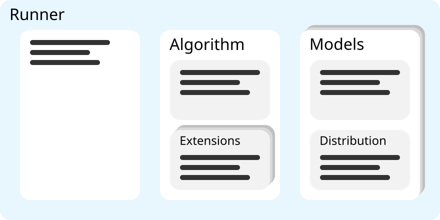
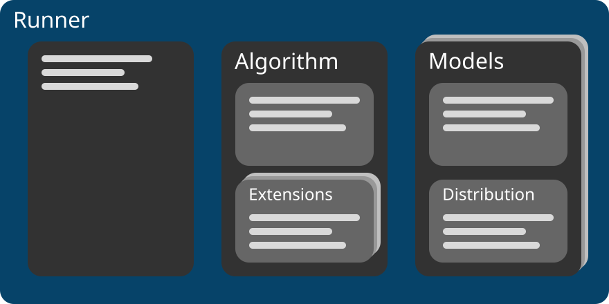

Configuration
=============

RSL-RL is configured with a dictionary that is passed to RSL-RL's runner during initialization. The dictionary is
usually read from a YAML file or constructed from Python dataclasses, such as in 
`Isaac Lab <https://github.com/isaac-sim/IsaacLab/blob/main/source/isaaclab_rl/isaaclab_rl/rsl_rl/rl_cfg.py>`__. 
It is nested to reflect the structure of the library, and follows this pattern:

The top level represents the runner configuration, which is composed of general settings and configuration dictionaries
for the algorithm (e.g. PPO), as well as for the models used by the algorithm (e.g. actor and critic). The algorithm 
dictionary contains the parameters of the algorithm, and may contain one or more configuration dictionaries for 
extensions. The model dictionaries contain the parameters of the models, and may contain a configuration dictionary for 
a distribution. 

In the following sections, we list the available settings for each configuration component, provide a minimal
:ref:`example configuration in YAML format <example-configuration>`, and explain how
:ref:`observations are configured <observation-configuration>`.

.. _runner-configuration:

Runner Configuration
--------------------

RSL-RL's :class:`~rsl_rl.runners.on_policy_runner.OnPolicyRunner` and 
:class:`~rsl_rl.runners.off_policy_runner.OffPolicyRunner` share the same configuration keys, which are listed below.

OnPolicyRunner & OffPolicyRunner
^^^^^^^^^^^^^^^^^^^^^^^^^^^^^^^^

.. list-table::
   :header-rows: 1
   :class: no-wrap-type-column

   * - Key
     - Type
     - Default
     - Description
   * - ``obs_groups``
     - dict[str, list[str]]
     - required
     - Mapping from observation sets to observation groups coming from the environment. See :ref:`here
       <observation-configuration>` for more details.
   * - ``num_steps_per_env``
     - int
     - required
     - Number of environment steps collected per iteration.
   * - ``save_interval``
     - int
     - required
     - Number of iterations between checkpoints.
   * - ``run_name``
     - str
     - missing
     - Optional run label shown in the console output.
   * - ``check_for_nan``
     - bool
     - ``True``
     - Whether to check for NaN or Inf values coming from the environment.
   * - ``torch_compile_mode``
     - str | None
     - ``None``
     - Compile mode for the PyTorch models to accelerate training.
       Valid values: ``None``, ``"default"``, ``"max-autotune-no-cudagraphs"``.
   * - ``logger``
     - str | dict
     - ``"tensorboard"``
     - Logging writer configuration. The plain strings ``"wandb"`` and ``"neptune"`` are 
       still accepted but deprecated.
   * - ``wandb_project``
     - str
     - --
     - Deprecated. Pass ``project_name`` inside the ``logger`` configuration instead.
   * - ``neptune_project``
     - str
     - --
     - Deprecated. Pass ``project_name`` inside the ``logger`` configuration instead.
   * - ``algorithm``
     - dict
     - required
     - RL algorithm configuration.
   * - ``actor``
     - dict
     - required
     - Actor model configuration.
   * - ``critic``
     - dict
     - required
     - Critic model configuration.

DistillationRunner
^^^^^^^^^^^^^^^^^^

For the :class:`~rsl_rl.runners.distillation_runner.DistillationRunner`, the ``actor`` and ``critic`` keys are simply
replaced by ``student`` and ``teacher`` keys, respectively:

.. list-table::
   :header-rows: 1
   :class: no-wrap-type-column

   * - Key
     - Type
     - Default
     - Description
   * - ...
     - ...
     - ...
     - ...
   * - ``student``
     - dict
     - required
     - Student model configuration.
   * - ``teacher``
     - dict
     - required
     - Teacher model configuration.

Logger
^^^^^^
The ``logger`` key of the runner configuration defines the logging writer used to log training metrics and other
information during training. RSL-RL supports TensorBoard, Weights & Biases, and Neptune out of the box. While
TensorBoard does not require any configuration and is set using the plain string ``"tensorboard"``, the other logging
backends are configured by passing a dictionary with the following keys:

.. list-table::
   :header-rows: 1
   :class: no-wrap-type-column

   * - Key
     - Type
     - Default
     - Description
   * - ``class_name``
     - str
     - required
     - Logger class name. Valid values: ``"WandbLogWriter"``, ``"NeptuneLogWriter"``.
   * - ``project_name``
     - str
     - required
     - Name of the project.

Algorithm Configuration
-----------------------

RSL-RL implements :class:`~rsl_rl.algorithms.ppo.PPO`, :class:`~rsl_rl.algorithms.sac.SAC`, 
and :class:`~rsl_rl.algorithms.distillation.Distillation`. Each algorithm has its own configuration listed below.

PPO
^^^

.. list-table::
   :header-rows: 1
   :class: no-wrap-type-column

   * - Key
     - Type
     - Default
     - Description
   * - ``class_name``
     - str
     - required
     - Algorithm class name. Valid values: ``"PPO"``.
   * - ``optimizer``
     - str
     - ``"adam"``
     - Optimizer used for policy/value updates. Valid values: see :func:`~rsl_rl.utils.utils.resolve_optimizer`.
   * - ``learning_rate``
     - float
     - ``0.001``
     - Optimizer learning rate.
   * - ``num_learning_epochs``
     - int
     - ``5``
     - Number of optimization epochs per iteration.
   * - ``num_mini_batches``
     - int
     - ``4``
     - Number of mini-batches per iteration.
   * - ``schedule``
     - str
     - ``"adaptive"``
     - Learning-rate schedule. Valid values: ``"adaptive"``, ``"fixed"``.
   * - ``value_loss_coef``
     - float
     - ``1.0``
     - Coefficient for the value-function loss.
   * - ``clip_param``
     - float
     - ``0.2``
     - PPO clipping parameter for surrogate/value clipping.
   * - ``use_clipped_value_loss``
     - bool
     - ``True``
     - Whether to clip the value loss.
   * - ``desired_kl``
     - float
     - ``0.01``
     - Target KL divergence used by the adaptive learning-rate schedule.
   * - ``entropy_coef``
     - float
     - ``0.01``
     - Entropy regularization coefficient.
   * - ``gamma``
     - float
     - ``0.99``
     - Discount factor.
   * - ``lam``
     - float
     - ``0.95``
     - GAE lambda parameter.
   * - ``max_grad_norm``
     - float
     - ``1.0``
     - Maximum gradient norm for gradient clipping.
   * - ``normalize_advantage_per_mini_batch``
     - bool
     - ``False``
     - Whether to normalize advantages for each mini-batch instead of across the entire rollout.
   * - ``use_mixed_precision``
     - bool
     - ``False``
     - Whether to run the forward pass and loss computation in bfloat16 autocast. Backward, gradient clipping, and
       the optimizer step always stay in fp32.
   * - ``share_cnn_encoders``
     - bool
     - ``False``
     - Whether to share the CNN networks between actor and critic in case
       the :class:`~rsl_rl.models.cnn_model.CNNModel` is used.
   * - ``rnd_cfg``
     - dict | None
     - ``None``
     - Optional RND extension configuration.
   * - ``symmetry_cfg``
     - dict | None
     - ``None``
     - Optional symmetry extension configuration.
   * - ``grad_reduce_bucket_mb``
     - float
     - ``25``
     - Maximum size, in megabytes, of a single packed gradient buffer used when reducing gradients
       across GPUs during multi-GPU training. Matches Torch's
       :class:`DistributedDataParallel` default ``bucket_cap_mb``.

SAC
^^^

.. list-table::
   :header-rows: 1
   :class: no-wrap-type-column

   * - Key
     - Type
     - Default
     - Description
   * - ``class_name``
     - str
     - required
     - Algorithm class name. Valid values: ``"SAC"``.
   * - ``num_critics``
     - int
     - ``2``
     - Number of state-action critics. 
   * - ``replay_buffer_capacity``
     - int
     - ``10000000``
     - Number of transitions that can be stored in the replay buffer.
   * - ``max_replay_memory_fraction``
     - float | None
     - ``None``
     - Maximum fraction of free GPU memory used for the replay buffer.
   * - ``num_updates``
     - int
     - ``16``
     - Number of optimization steps per iteration.
   * - ``batch_size``
     - int
     - ``2048``
     - Number of transitions sampled per optimization step.
   * - ``num_return_steps``
     - int
     - ``3``
     - Maximum number of environment steps used to compute return targets.
   * - ``gamma``
     - float
     - ``0.98``
     - Discount factor.
   * - ``tau``
     - float
     - ``0.01``
     - Interpolation factor for updating the target critics.
   * - ``actor_update_interval``
     - int
     - ``2``
     - Number of critic updates per actor update.
   * - ``num_warmup_transitions``
     - int
     - ``100000``
     - Minimum number of transitions in the replay buffer before optimization starts.
   * - ``actor_learning_rate``
     - float
     - ``0.0001``
     - Optimizer learning rate for the actor.
   * - ``critic_learning_rate``
     - float
     - ``0.0001``
     - Optimizer learning rate for the critics.
   * - ``alpha_learning_rate``
     - float
     - ``0.0001``
     - Optimizer learning rate for the entropy temperature.
   * - ``max_grad_norm``
     - float | None
     - ``None``
     - Maximum gradient norm for gradient clipping of the actor and critics.
   * - ``optimizer``
     - str
     - ``"adam"``
     - Optimizer used for actor and critic updates. Valid values: see :func:`~rsl_rl.utils.utils.resolve_optimizer`.
       The entropy temperature uses Adam.
   * - ``weight_decay``
     - float
     - ``0.0``
     - Weight decay for the actor and critic optimizers.
   * - ``init_alpha``
     - float
     - ``0.01``
     - Initial entropy temperature.
   * - ``target_entropy``
     - float | None
     - ``None``
     - Target policy entropy. If ``None``, the target is computed from ``target_entropy_std`` when provided, or set to
       the negative action dimension.
   * - ``target_entropy_std``
     - float | None
     - ``0.15``
     - Gaussian standard deviation used to compute the target entropy. Only used if ``target_entropy`` is ``None``.
   * - ``critic_loss_type``
     - str
     - ``"categorical"``
     - Loss used for critic updates. Valid values: ``"mse"``, ``"categorical"``.
   * - ``num_bins``
     - int
     - ``101``
     - Number of bins for categorical critics. Only used if ``critic_loss_type`` is ``"categorical"``.
   * - ``value_range``
     - tuple[float, float]
     - ``(-5.0, 5.0)``
     - Minimum and maximum values represented by categorical critics. Only used if ``critic_loss_type`` is
       ``"categorical"``.
   * - ``reward_normalization``
     - bool
     - ``True``
     - Whether to normalize rewards using statistics of discounted returns.
   * - ``reward_normalization_max_return``
     - float
     - ``5.0``
     - Maximum absolute value of tracked discounted returns after reward normalization. Only used if 
       ``reward_normalization`` is ``True``.
   * - ``exploration_type``
     - str
     - ``"held"``
     - Exploration noise. Valid values: ``"gaussian"`` (resampled each step), ``"held"`` (reused across multiple steps).
   * - ``noise_repeat_exponent``
     - float
     - ``2.0``
     - Exponent of the power-law distribution for noise repetition counts. Only used if ``exploration_type`` is
       ``"held"``.
   * - ``max_noise_repeat_steps``
     - int
     - ``16``
     - Maximum number of environment steps for which exploration noise is held. Only used if ``exploration_type`` is
       ``"held"``.
   * - ``learning_rate_schedule``
     - str
     - ``"constant"``
     - Learning-rate schedule. Valid values: ``"constant"``, ``"cosine"``.
   * - ``final_learning_rate_ratio``
     - float
     - ``0.5``
     - Final learning rate as a fraction of the initial learning rate. Only used if ``learning_rate_schedule`` is
       ``"cosine"``.
   * - ``num_schedule_updates``
     - int | None
     - ``None``
     - Number of optimization steps over which the cosine schedule runs. Required if ``learning_rate_schedule`` is
       ``"cosine"``.
   * - ``use_mixed_precision``
     - bool
     - ``False``
     - Whether to run the forward pass and loss computation in bfloat16 autocast. Backward, gradient clipping, and
       the optimizer step always stay in fp32.
   * - ``use_cuda_graph``
     - bool
     - ``False``
     - Whether to capture optimization steps in CUDA graphs.
   * - ``symmetry_cfg``
     - dict | None
     - ``None``
     - Optional symmetry extension configuration.
   * - ``grad_reduce_bucket_mb``
     - float
     - ``25``
     - Maximum gradient-reduction buffer size in megabytes for distributed training.
   * - ``validate_final_obs``
     - bool | None
     - ``None``
     - Whether SAC rejects nonfinite final observations in :meth:`~rsl_rl.algorithms.sac.SAC.update`, which costs one
       synchronization per iteration. ``None`` resolves to ``False`` on a single GPU if the runner configuration sets
       ``check_for_nan=True``, whose check already covers final observations, and to ``True`` otherwise.

The SAC defaults are the configuration that worked best across Isaac Lab locomotion benchmark tasks. These runs used
residual networks for the actor and critics, and an actor action range of ``(-2.0, 2.0)``:

.. code-block:: yaml

   actor:
     class_name: MLPModel
     network_cfg:
       class_name: ResidualMLP
       hidden_dim: 128
     distribution_cfg:
       class_name: SquashedGaussianDistribution
       action_range: [-2.0, 2.0]
   critic:
     class_name: QMLPModel
     network_cfg:
       class_name: ResidualMLP
       hidden_dim: 256

The action range is the setting most likely to need task-specific tuning. For example, joint-position tasks whose
targets lie far from the default pose may need a larger range.

SAC distributed training
~~~~~~~~~~~~~~~~~~~~~~~~

``OffPolicyRunner`` uses the same ``torchrun``/NCCL setup as ``OnPolicyRunner``. Pass
``device=f"cuda:{os.environ['LOCAL_RANK']}"`` to each runner and create its environments on that device.
The standalone algorithm also accepts an already initialized Gloo process group for CPU execution via ``multi_gpu_cfg``.
With NCCL, ``use_cuda_graph=True`` captures the gradient and statistics all-reduces together with the updates and
the environment-step processing; the Gloo backend does not support capture. The captured graphs must be released
before the process group is destroyed: ``OnPolicyRunner.learn()`` does this when it returns; code that drives the
algorithm directly calls :meth:`~rsl_rl.algorithms.sac.SAC.release_cuda_graphs`.

Replay capacity, warm-up transitions, and batch size are per rank. Every rank must use the same model and algorithm
configuration and call collection and updates in the same order. An update starts only when every rank's replay is
ready. Actor, critic, target, temperature, and normalizer state are initially broadcast from rank zero. Actor, critic,
and temperature gradients are averaged before clipping or stepping. Observation and return normalizers compute global
sample-weighted moments; the return-magnitude bound uses a global maximum. BatchNorm forward passes use local minibatch
statistics, with running floating-point buffers averaged and integer counters synchronized after each learner step.
This is not SyncBatchNorm.

On resume, all ranks must load the same checkpoint and load configuration, including optimizer and scheduler state
when continuing training. Replay and environment trajectories remain local and are not checkpointed; each rank refills
replay before updates resume. Actor/critic update counters and schedules are restored from the checkpoint.

SAC final observations
~~~~~~~~~~~~~~~~~~~~~~

The consumed ``final_obs`` rows must be finite for both hard terminals and timeouts. Invalid final rows are rejected
before replay insertion; the standalone distributed SAC algorithm propagates this error to all ranks. The runner's
own finite check may raise earlier on the affected rank. Unused rows for environments that did not
reset are ignored. Timeouts bootstrap from their final pre-reset observation. Hard terminals have zero bootstrap
discount. Before learner forward passes, nonfinite terminal successor inputs are replaced by the corresponding current
observations, so invalid terminal successors from externally populated replay cannot enter actor/critic forwards or
BatchNorm statistics. Finite terminal successor inputs retain the original BatchNorm behavior. This replacement
preserves fixed batch shapes for single-device CUDA graphs.

SAC image observations
~~~~~~~~~~~~~~~~~~~~~~

Use ``CNNModel`` for an image actor and ``QCNNModel`` for an image critic. Both use the existing ``cnn_cfg`` interface.
Each selected image group has shape ``(batch, channels, height, width)``; vector groups have shape ``(batch, features)``.
Replay retains these shapes. Either model can use images alone or images plus vector groups, and actor/critic groups
may differ. The critic concatenates runtime candidate actions after the image and vector features, before its MLP or
configured ``network_cfg``. ``action_dim`` is inferred from ``env.num_actions``; do not add candidate actions to the
observation groups. Q outputs are scalar values or categorical logits according to the SAC configuration.

For example, set the following model and observation entries in an otherwise configured SAC runner:

.. code-block:: python

   cfg["obs_groups"] = {"actor": ["policy", "image"], "critic": ["critic", "image"]}
   cfg["actor"] = {
       "class_name": "CNNModel",
       "hidden_dims": [256, 256],
       "cnn_cfg": {"output_channels": [16, 32], "kernel_size": 3, "stride": 2, "flatten": True},
       "distribution_cfg": {"class_name": "SquashedGaussianDistribution"},
   }
   cfg["critic"] = {
       "class_name": "QCNNModel",
       "hidden_dims": [256, 256],
       "cnn_cfg": {"output_channels": [16, 32], "kernel_size": 3, "stride": 2, "flatten": True},
   }

SAC requires separate parameters for the actor and each critic, including image encoders. CNN actors support the
standard runner's TorchScript and ONNX exports; state-action critic export is not supported.

SAC recurrent-model limitation
~~~~~~~~~~~~~~~~~~~~~~~~~~~~~~

Recurrent actors and critics are explicitly rejected. The current replay ``length`` is an n-step return window,
not a recurrent training sequence: ``ReplayBuffer.Batch`` provides only the initial observations/actions and the final
successor observations. Its time-indexed ``rewards`` tensor does not include observation/action sequences.
The ``valid`` mask controls return accumulation, not recurrent loss padding. No hidden states are stored.

``RNNModel`` expects a time-major observation sequence, padding masks and an initial hidden state during updates.
Without these inputs its forward pass instead advances the rollout hidden state. Using it on independent random
replay samples would mix unrelated episode histories and could overwrite the state used for environment interaction.
Calling ``reset(dones)`` during collection alone cannot make that update correct.

Correct recurrent SAC would require observation/action sequences with episode boundaries, burn-in or stored initial
states, padding-aware losses, and separate history reconstruction for the actor, online critics and target critics.
Target hidden states must be computed using target weights, not copied from an online critic. Timeout successors need
the pre-reset history while the following episode starts from reset state; hard terminals must never bootstrap across
that boundary. The actor's candidate-action Q evaluation must preserve replay history without mutating rollout or
target hidden state. These changes span replay, model interfaces and learner updates and are intentionally deferred.
No recurrent SAC support is claimed by this implementation.

Distillation
^^^^^^^^^^^^

.. list-table::
   :header-rows: 1
   :class: no-wrap-type-column

   * - Key
     - Type
     - Default
     - Description
   * - ``class_name``
     - str
     - required
     - Algorithm class name. Valid values: ``"Distillation"``.
   * - ``optimizer``
     - str
     - ``"adam"``
     - Optimizer used for student updates. Valid values: see :func:`~rsl_rl.utils.utils.resolve_optimizer`.
   * - ``learning_rate``
     - float
     - ``1e-3``
     - Optimizer learning rate.
   * - ``num_learning_epochs``
     - int
     - ``1``
     - Number of optimization epochs per iteration.
   * - ``gradient_length``
     - int
     - ``15``
     - Gradient backpropagation length.
   * - ``max_grad_norm``
     - float | None
     - ``None``
     - Maximum gradient norm for gradient clipping.
   * - ``loss_type``
     - str
     - ``"mse"``
     - Loss type. Valid values: ``"mse"``, ``"huber"``.
   * - ``use_mixed_precision``
     - bool
     - ``False``
     - Whether to run the forward pass and loss computation in bfloat16 autocast. Backward, gradient clipping, and
       the optimizer step always stay in fp32.
   * - ``grad_reduce_bucket_mb``
     - float
     - ``25``
     - Maximum size, in megabytes, of a single packed gradient buffer used when reducing gradients
       across GPUs during multi-GPU training. Matches
       :class:`torch.nn.parallel.DistributedDataParallel`'s default ``bucket_cap_mb``.

SuperMimic
^^^^^^^^^^

SuperMimic uses ``actor``, ``world_model`` and ``critic`` model configurations. ``task_cfg.class_name`` resolves a
:class:`~rsl_rl.algorithms.supermimic_task.DifferentiableTask` with ``env``, ``device`` and the remaining task kwargs.
The task supplies physical coordinates, rewards and feature construction.
Actor Adam uses betas ``(0.9, 0.95)`` and clips each gradient value to ``[-0.1, 0.1]`` after global norm clipping.

.. list-table::
   :header-rows: 1
   :class: no-wrap-type-column

   * - Key
     - Type
     - Default
     - Description
   * - ``class_name``
     - str
     - required
     - ``"SuperMimic"``.
   * - ``task_cfg``
     - dict
     - required
     - Differentiable task class and kwargs.
   * - ``replay_buffer_capacity``
     - int
     - ``1000000``
     - Total physical transitions across environments; allocated lazily.
   * - ``max_replay_memory_fraction``
     - float | None
     - ``None``
     - Optional fraction of free device memory available to replay.
   * - ``updates_per_step``
     - float
     - ``0.4``
     - Learner iterations accrued per collected environment step.
   * - ``num_warmup_steps``
     - int
     - ``64``
     - Stored steps per environment before learning; must cover ``world_model_window``.
   * - ``num_world_model_warmup_iterations``
     - int
     - ``500``
     - Learner iterations fitting only dynamics.
   * - ``num_world_model_updates``
     - int
     - ``10``
     - Dynamics optimizer steps per learner iteration.
   * - ``world_model_window``
     - int
     - ``8``
     - Maximum autoregressive dynamics fitting horizon.
   * - ``world_model_batch_size``
     - int
     - ``2048``
     - Replay anchors per dynamics optimizer step.
   * - ``num_policy_updates``
     - int
     - ``1``
     - Actor updates and associated critic fits per learner iteration.
   * - ``horizon``
     - int
     - ``32``
     - Imagined policy horizon.
   * - ``policy_batch_size``
     - int
     - ``4096``
     - Starts per actor update.
   * - ``gamma``
     - float
     - ``0.99``
     - Reward discount.
   * - ``max_step_reward``
     - float | None
     - ``None``
     - Optional per-step reward bound used to cap values at the maximum discounted return.
   * - ``action_noise``
     - float
     - ``0.1``
     - Standard deviation of additive collection noise.
   * - ``actor_ema_halflife``
     - int | None
     - ``None``
     - Deployment-only actor exponential moving average (EMA) half-life in actor optimizer steps, e.g. ``500``.
   * - ``lam``
     - float
     - ``0.95``
     - TD(lambda) mixing coefficient for value targets.
   * - ``num_critic_epochs``
     - int
     - ``5``
     - Epochs per critic fit.
   * - ``num_critic_mini_batches``
     - int
     - ``4``
     - Minibatches per critic epoch.
   * - ``learning_rate``
     - float
     - ``2e-4``
     - Initial learning rate for all optimizers.
   * - ``max_grad_norm``
     - float
     - ``1.0``
     - Global gradient-norm limit for each model.
   * - ``num_schedule_updates``
     - int
     - ``250000``
     - Learner iterations in the shared cosine learning-rate schedule.
   * - ``final_learning_rate_ratio``
     - float
     - ``0.03``
     - Final learning rate relative to its initial value.
   * - ``use_mixed_precision``
     - bool
     - ``False``
     - Enable BF16 matrix operations while integrating physical states in FP32.
   * - ``use_cuda_graph``
     - bool
     - ``False``
     - Capture each learner iteration in a CUDA graph. Requires a CUDA device and task heads without host
       synchronization.

When enabled, inference and JIT/ONNX exports use EMA parameters with live normalization buffers.
Collection and policy optimization keep using the live actor.
After each successful actor step ``n``, the averaging decay is
``min(0.5 ** (1 / h), (1 + n) / (10 + n))``, where ``h`` is the half-life and ``n`` starts at one.
``None`` disables averaging. Use the same ``actor_ema_halflife`` setting for training and play/export.
In Isaac Lab, pass ``agent.algorithm.actor_ema_halflife=500`` to play with or export that EMA actor.

Model Configuration
-------------------

Different algorithms use models for different purposes. For example, :class:`~rsl_rl.algorithms.ppo.PPO` uses an actor
and a critic, while :class:`~rsl_rl.algorithms.distillation.Distillation` uses a student and a teacher. Even though
their function may differ, algorithms can generally use the same underlying model classes. Available models include
:class:`~rsl_rl.models.mlp_model.MLPModel`, :class:`~rsl_rl.models.rnn_model.RNNModel`, and
:class:`~rsl_rl.models.cnn_model.CNNModel`, :class:`~rsl_rl.models.mlp_model.QMLPModel`, and
:class:`~rsl_rl.models.cnn_model.QCNNModel`.

MLPModel
^^^^^^^^

.. list-table::
   :header-rows: 1
   :class: no-wrap-type-column

   * - Key
     - Type
     - Default
     - Description
   * - ``class_name``
     - str
     - required
     - Model class name. Valid values: ``"MLPModel"``.
   * - ``hidden_dims``
     - tuple[int] | list[int]
     - ``[256, 256, 256]``
     - Hidden dimensions of the MLP.
   * - ``activation``
     - str
     - ``"elu"``
     - Activation function of the MLP. Valid values: see :func:`~rsl_rl.utils.utils.resolve_nn_activation`.
   * - ``obs_normalization``
     - bool
     - ``False``
     - Whether to normalize the observations before passing them to the MLP.
   * - ``network_cfg``
     - dict | None
     - ``None``
     - Optional network configuration. If provided, the default MLP is replaced by the configured network, and
       ``hidden_dims`` and ``activation`` are ignored.
   * - ``distribution_cfg``
     - dict | None
     - ``None``
     - Optional output distribution configuration. If provided, the model can output stochastic values sampled from 
       the specified distribution.

The ``network_cfg`` dictionary contains the network's ``class_name`` and configuration parameters. For
:class:`~rsl_rl.models.rnn_model.RNNModel` and :class:`~rsl_rl.models.cnn_model.CNNModel`, it replaces the MLP after the
recurrent network or CNN encoders. To use the :class:`~rsl_rl.modules.mlp.ResidualMLP`, configure the following
parameters:

.. list-table::
   :header-rows: 1
   :class: no-wrap-type-column

   * - Key
     - Type
     - Default
     - Description
   * - ``class_name``
     - str
     - required
     - Network class name. Valid values: ``"ResidualMLP"``.
   * - ``hidden_dim``
     - int
     - ``256``
     - Hidden dimension of the residual network.
   * - ``num_blocks``
     - int
     - ``2``
     - Number of residual blocks.
   * - ``expansion``
     - int
     - ``4``
     - Expansion factor for the hidden dimension within each residual block.
   * - ``batch_norm_momentum``
     - float
     - ``0.01``
     - Momentum for the running statistics of batch normalization.

The :class:`~rsl_rl.modules.mlp.ResidualMLP` requires :meth:`~rsl_rl.modules.mlp.ResidualMLP.normalize_parameters` to be 
called after each optimizer step. Currently, only :class:`~rsl_rl.algorithms.sac.SAC` performs this normalization.

RNNModel
^^^^^^^^

The :class:`~rsl_rl.models.rnn_model.RNNModel` inherits from the :class:`~rsl_rl.models.mlp_model.MLPModel` and shares
the same configuration keys, with the addition of the following keys:

.. list-table::
   :header-rows: 1
   :class: no-wrap-type-column

   * - Key
     - Type
     - Default
     - Description
   * - ``class_name``
     - str
     - required
     - Model class name. Valid values: ``"RNNModel"``.
   * - ...
     - ...
     - ...
     - ...
   * - ``rnn_type``
     - str
     - ``"lstm"``
     - Type of RNN network. Valid values: ``"lstm"``, ``"gru"``.
   * - ``rnn_hidden_dim``
     - int
     - ``256``
     - Hidden dimension of the RNN.
   * - ``rnn_num_layers``
     - int
     - ``1``
     - Number of RNN layers.
  
CNNModel
^^^^^^^^

The :class:`~rsl_rl.models.cnn_model.CNNModel` inherits from the :class:`~rsl_rl.models.mlp_model.MLPModel` and shares
the same configuration keys, with the addition of the following keys:

.. list-table::
   :header-rows: 1
   :class: no-wrap-type-column

   * - Key
     - Type
     - Default
     - Description
   * - ``class_name``
     - str
     - required
     - Model class name. Valid values: ``"CNNModel"``.
   * - ...
     - ...
     - ...
     - ...
   * - ``cnn_cfg``
     - dict[str, dict] | dict[str, Any] | None
     - ``None``
     - Configuration of the CNN encoder(s).

Instead of directly passing the CNN parameters to the :class:`~rsl_rl.models.cnn_model.CNNModel` (similar to how it is 
done for the :class:`~rsl_rl.models.mlp_model.MLPModel` and :class:`~rsl_rl.models.rnn_model.RNNModel`), the parameters 
are grouped in a dictionary ``cnn_cfg``. This enables passing multiple CNN configurations for different observations 
(e.g. different cameras). If only one CNN is needed or all CNNs have the same configuration, the dictionary may directly 
contain the CNN parameters. If multiple CNNs with different configurations are needed, the dictionary must contain a 
dictionary for each CNN configuration, with the key being the observation the configuration applies to. The 
:class:`~rsl_rl.models.cnn_model.CNNModel` will then create CNNs based on the provided configurations. A CNN
configuration includes the following parameters:

.. list-table::
   :header-rows: 1
   :class: no-wrap-type-column

   * - Key
     - Type
     - Default
     - Description
   * - ``output_channels``
     - tuple[int] | list[int]
     - required
     - Output channels for each convolutional layer.
   * - ``kernel_size``
     - int | tuple[int] | list[int]
     - required
     - Kernel size for each convolutional layer or a single kernel size for all layers.
   * - ``stride``
     - int | tuple[int] | list[int]
     - ``1``
     - Stride for each convolutional layer or a single stride for all layers.
   * - ``dilation``
     - int | tuple[int] | list[int]
     - ``1``
     - Dilation for each convolutional layer or a single dilation for all layers.
   * - ``padding``
     - str
     - ``"none"``
     - Padding type to use. Valid values: ``"none"``, ``"zeros"``, ``"reflect"``, ``"replicate"``, ``"circular"``.
   * - ``norm``
     - str | tuple[str] | list[str]
     - ``"none"``
     - Normalization type for each convolutional layer or a single normalization type for all layers. Valid values: 
       ``"none"``, ``"batch"``, ``"layer"``.
   * - ``activation``
     - str
     - ``"elu"``
     - Activation function to use. Valid values: see :func:`~rsl_rl.utils.utils.resolve_nn_activation`.
   * - ``max_pool``
     - bool | tuple[bool] | list[bool]
     - ``False``
     - Whether to apply max pooling after each convolutional layer or a single boolean for all layers.
   * - ``global_pool``
     - str
     - ``"none"``
     - Global pooling type to apply at the end. Valid values: ``"none"``, ``"max"``, ``"avg"``.
   * - ``flatten``
     - bool
     - ``True``
     - Whether to flatten the output tensor.

QMLPModel
^^^^^^^^^

The :class:`~rsl_rl.models.mlp_model.QMLPModel` inherits from the :class:`~rsl_rl.models.mlp_model.MLPModel` and shares
the same configuration keys, except that ``distribution_cfg`` must be ``None``.

.. list-table::
   :header-rows: 1
   :class: no-wrap-type-column

   * - Key
     - Type
     - Default
     - Description
   * - ``class_name``
     - str
     - required
     - Model class name. Valid values: ``"QMLPModel"``.
   * - ...
     - ...
     - ...
     - ...

SuperMimicActor
^^^^^^^^^^^^^^^

The actor consumes deployable features from the task and exports explicit ``obs_history`` and optional ``goal`` inputs.
Feature widths are inferred at construction.

.. list-table::
   :header-rows: 1
   :class: no-wrap-type-column

   * - Key
     - Type
     - Default
     - Description
   * - ``class_name``
     - str
     - required
     - ``"SuperMimicActor"``.
   * - ``history_length``
     - int
     - ``5``
     - Number of actor frames; reset history repeats its first frame.
   * - ``latent_dim``
     - int
     - ``32``
     - Encoded goal width.
   * - ``encoder_hidden_dims``
     - tuple[int]
     - ``(2048, 1024, 512, 256)``
     - Goal encoder layers.
   * - ``decoder_hidden_dims``
     - tuple[int]
     - ``(2048, 1024, 512, 256)``
     - Action decoder layers.

WorldModel
^^^^^^^^^^

The world model predicts physical increments and optional successor event labels. The task defines integration
coordinates and feature widths.

.. list-table::
   :header-rows: 1
   :class: no-wrap-type-column

   * - Key
     - Type
     - Default
     - Description
   * - ``class_name``
     - str
     - required
     - ``"WorldModel"``.
   * - ``hidden_dims``
     - tuple[int]
     - ``(2048, 2048, 2048)``
     - Dynamics network layers with LayerNorm.
   * - ``label_hidden_dims``
     - tuple[int]
     - ``(512, 512)``
     - Optional event-head layers.

Distribution Configuration
--------------------------

RSL-RL provides the following distributions for stochastic model outputs:
:class:`~rsl_rl.modules.distribution.GaussianDistribution`,
:class:`~rsl_rl.modules.distribution.HeteroscedasticGaussianDistribution` with state-dependent standard deviation,
:class:`~rsl_rl.modules.distribution.SquashedGaussianDistribution` for tanh-bounded Gaussian actions, and
:class:`~rsl_rl.modules.distribution.BetaDistribution` for naturally bounded action spaces.

GaussianDistribution
^^^^^^^^^^^^^^^^^^^^

.. list-table::
   :header-rows: 1
   :class: no-wrap-type-column

   * - Key
     - Type
     - Default
     - Description
   * - ``class_name``
     - str
     - required
     - Distribution class name. Valid values: ``"GaussianDistribution"``.
   * - ``init_std``
     - float
     - ``1.0``
     - Initial standard deviation for all dimensions.
   * - ``std_range``
     - tuple[float, float]
     - ``(1e-6, 1e6)``
     - Minimum and maximum allowed values for the standard deviation for numerical stability.
   * - ``std_type``
     - str
     - ``"scalar"``
     - Whether the standard deviation is stored directly or in log-space. Valid values: ``"scalar"``, ``"log"``.
   * - ``learn_std``
     - bool
     - ``True``
     - Whether the standard deviation is learnable or fixed.

HeteroscedasticGaussianDistribution
^^^^^^^^^^^^^^^^^^^^^^^^^^^^^^^^^^^

.. list-table::
   :header-rows: 1
   :class: no-wrap-type-column

   * - Key
     - Type
     - Default
     - Description
   * - ``class_name``
     - str
     - required
     - Distribution class name. Valid values: ``"HeteroscedasticGaussianDistribution"``.
   * - ``init_std``
     - float
     - ``1.0``
     - Initial standard deviation (used to initialize the std head bias).
   * - ``std_range``
     - tuple[float, float]
     - ``(1e-6, 1e6)``
     - Minimum and maximum allowed values for the standard deviation for numerical stability.
   * - ``std_type``
     - str
     - ``"scalar"``
     - Whether the standard deviation is stored directly or in log-space. Valid values: ``"scalar"``, ``"log"``.

SquashedGaussianDistribution
^^^^^^^^^^^^^^^^^^^^^^^^^^^^

.. list-table::
   :header-rows: 1
   :class: no-wrap-type-column

   * - Key
     - Type
     - Default
     - Description
   * - ``class_name``
     - str
     - required
     - Distribution class name. Valid values: ``"SquashedGaussianDistribution"``.
   * - ``init_std``
     - float | None
     - ``None``
     - Initial standard deviation before squashing (used to initialize the standard deviation head). ``None`` uses the
       network's default initialization.
   * - ``std_range``
     - tuple[float, float]
     - ``(math.exp(-5.0), math.exp(2.0))``
     - Minimum and maximum standard deviation of the Gaussian before applying the tanh function.
   * - ``action_range``
     - tuple[float | list, float | list]
     - ``(-1.0, 1.0)``
     - Interval ``(min, max)`` to which squashed samples are linearly rescaled. Each bound can be a scalar or a list
       with one value per action dimension.

BetaDistribution
^^^^^^^^^^^^^^^^

.. list-table::
   :header-rows: 1
   :class: no-wrap-type-column

   * - Key
     - Type
     - Default
     - Description
   * - ``class_name``
     - str
     - required
     - Distribution class name. Valid values: ``"BetaDistribution"``.
   * - ``action_range``
     - tuple[float, float]
     - ``(-1.0, 1.0)``
     - Interval ``(min, max)`` to which samples are linearly rescaled. The Beta distribution naturally produces samples
       in ``[0, 1]``, which are rescaled to this range.

Extension Configuration
-----------------------

:class:`~rsl_rl.extensions.rnd.RandomNetworkDistillation` is compatible with :class:`~rsl_rl.algorithms.ppo.PPO`, and
:class:`~rsl_rl.extensions.symmetry.Symmetry` is compatible with :class:`~rsl_rl.algorithms.ppo.PPO` and
:class:`~rsl_rl.algorithms.sac.SAC`. The configuration keys for both extensions are listed below.

Random Network Distillation
^^^^^^^^^^^^^^^^^^^^^^^^^^^

.. list-table::
   :header-rows: 1
   :class: no-wrap-type-column

   * - Key
     - Type
     - Default
     - Description
   * - ``num_outputs``
     - int
     - required
     - Number of outputs of the RND networks.
   * - ``predictor_hidden_dims``
     - tuple[int] | list[int]
     - required
     - Hidden dimensions of the RND predictor network.
   * - ``target_hidden_dims``
     - tuple[int] | list[int]
     - required
     - Hidden dimensions of the RND target network.
   * - ``activation``
     - str
     - ``"elu"``
     - Activation function for the RND networks. Valid values: see :func:`~rsl_rl.utils.utils.resolve_nn_activation`.
   * - ``state_normalization``
     - bool
     - ``False``
     - Whether to normalize the RND state.
   * - ``reward_normalization``
     - bool
     - ``False``
     - Whether to normalize the RND reward.
   * - ``weight``
     - float
     - ``0.0``
     - Initial weight of the RND reward.
   * - ``weight_schedule``
     - dict | None
     - ``None``
     - Weight schedule for the RND reward. Valid values: see :class:`~rsl_rl.extensions.rnd.RandomNetworkDistillation`.
   * - ``learning_rate``
     - float
     - ``0.001``
     - Learning rate for the RND optimizer.

Symmetry Augmentation
^^^^^^^^^^^^^^^^^^^^^

.. list-table::
   :header-rows: 1
   :class: no-wrap-type-column

   * - Key
     - Type
     - Default
     - Description
   * - ``use_data_augmentation``
     - bool
     - required
     - Whether to add symmetric trajectories to the batch.
   * - ``data_augmentation_func``
     - str | callable | None
     - required
     - Function to generate symmetric trajectories. Resolved using :func:`~rsl_rl.utils.utils.resolve_callable`.
   * - ``use_mirror_loss``
     - bool
     - required
     - Whether to add a symmetry loss term to the loss function.
   * - ``mirror_loss_coeff``
     - float
     - required
     - Coefficient for the symmetry loss.

.. _example-configuration:

Example Configuration
---------------------

While the previous sections make it seem rather complicated to set up a configuration, the required configuration to run 
a training with, e.g., :class:`~rsl_rl.algorithms.ppo.PPO` is actually quite simple. The following configuration is
already sufficient:

.. code-block:: yaml

   runner:
     num_steps_per_env: 24
     obs_groups: {"actor": ["policy"], "critic": ["policy", "privileged"]}
     save_interval: 100
     algorithm:
       class_name: PPO
     actor:
       class_name: MLPModel
       distribution_cfg:
         class_name: GaussianDistribution
     critic:
       class_name: MLPModel

.. _observation-configuration:

Observation Configuration
-------------------------

RSL-RL expects the :func:`~rsl_rl.env.vec_env.VecEnv.step` method of the environment to return observations as a 
:class:`~tensordict.tensordict.TensorDict`. This dictionary contains one or more tensors with observation data, referred 
to as *observation groups* in RSL-RL and Isaac Lab.

The ``obs_groups`` dictionary of the :ref:`runner configuration <runner-configuration>` defines which observation groups
are used for which purpose. Each purpose defines its own *observation set*, which is simply a list of observation 
groups. In other words, the ``obs_groups`` dictionary maps from *observation sets* to lists of *observation groups*.

As the above definition is quite abstract, let's consider a simple example for a
:class:`~rsl_rl.algorithms.ppo.PPO` training. The :func:`~rsl_rl.env.vec_env.VecEnv.step` method of our environment 
might return the following observations:

.. code-block:: python

  obs = TensorDict(
    {
      "policy": torch.tensor([1.0, 2.0, 3.0]), # available during robot deployment
      "privileged": torch.tensor([4.0, 5.0, 6.0]), # only available during training
    }
  )

Let's assume the "policy" observation group is meant for both actor and critic. The "privileged" observation group is 
only available during training and therefore cannot be used by the actor model, but may still improve learning 
performance when passed to the critic. Thus, the ``obs_groups`` dictionary would be configured as follows:

.. code-block:: yaml

   obs_groups: {"actor": ["policy"], "critic": ["policy", "privileged"]}

With this configuration, the actor would receive the "policy" tensor as input, while the critic would receive both the 
"policy" and the "privileged" tensor as input. 

Depending on the algorithm and extensions used, RSL-RL expects different observation sets to be present in the 
``obs_groups`` dictionary. Currently, the following observation sets may be required, depending on the configuration:

.. list-table::
   :header-rows: 1
   :class: no-wrap-type-column

   * - Key
     - Description
   * - ``actor``
     - Observations used as input to the actor model.
   * - ``critic``
     - Observations used as input to the critic model.
   * - ``student``
     - Observations used as input to the student model.
   * - ``teacher``
     - Observations used as input to the teacher model.
   * - ``rnd_state``
     - Observations used as input to the RND extension.

   * - ``state``
     - SuperMimic physical state, noise-free; required without a policy-group fallback.
   * - ``goal``
     - Optional SuperMimic task goal.
   * - ``context``
     - Optional noise-free privileged dynamics and critic context.
   * - ``labels``
     - Optional binary successor events with ``task.num_labels`` columns.
   * - ``prev_action`` / ``prev_prev_action``
     - Optional action vectors overriding SuperMimic's collection history, including nonzero reset commands.

SuperMimic optional sets must be mapped explicitly. Its critic inputs are constructed by ``task.critic_obs``;
do not map a ``critic`` set for this algorithm. Task action histories are oldest-first with shape
``[..., task.action_history_length, num_actions]``.

Incomplete or incorrect configurations are handled in :func:`~rsl_rl.utils.utils.resolve_obs_groups`, which provides 
detailed information on how errors are resolved.
